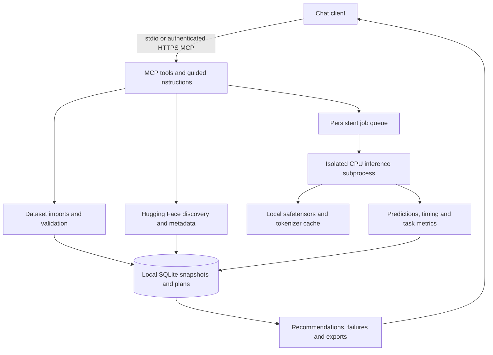

# Architecture

## Modules

- `config.py`: installation limits and filesystem roots.
- `data.py`: strict normalization, imports, seeded sampling and Hub streaming.
- `models.py`: candidate metadata, immutable revisions, safe-weight checks and label mapping.
- `engine.py`: single-owner lock, durable records, queue, schedules, supervision and cancellation.
- `worker.py`: one subprocess per job; loads candidates sequentially, warms up, evaluates and measures.
- `metrics.py`: classification scores, errors, latency percentiles and constrained recommendations.
- `reports.py`: raw-text-free exports, integration generation and run comparisons.
- `auth.py`: personal OAuth authorization, PKCE integration, consent, token rotation and revocation.
- `server.py`: MCP tool contracts, annotations, instructions, HTTP lifecycle and health route.
- `cli.py`: setup, diagnostics and server launch.

## Lifecycle

`dataset -> plan -> job -> aggregate report / opt-in examples / integration code`

Plans pin model and source revisions, selected row IDs, label mappings, token limit and hashes.
Every candidate gets identical rows in identical order. Classification uses one prediction per row.
Errors remain part of the denominator and disqualify a candidate from recommendation.

The queue has one active subprocess and up to three active/queued jobs. Each job has its own private
working directory. Atomic JSON files carry progress/results to the supervisor, which persists results
and removes working files on completion/cancellation. Status transitions are queued -> running ->
completed/partial/failed, or cancelling -> cancelled. Startup marks abandoned jobs interrupted.
The supervisor checks runtime, process RSS, available system RAM and cancellation periodically.

The HTTP application owns the Engine, not an individual stateless MCP request. Closing a request must
never stop an evaluation. Stdio owns the Engine for the lifetime of that connection. One home has one
service owner; multiple clients use the same HTTP process.

## Boundaries

Model execution supports standard Transformers sequence classifiers, safetensors, CPU and single-label
outputs. It refuses missing/mismatched checkpoint keys and remote model code. It does not infer what a
generic `LABEL_0` means. Explicit mappings must cover both ontologies one-to-one.

The server is a personal worker, not a hardened multi-tenant platform. Authorized chat clients can access
all records and the configured dataset directory. Remote consent is a one-time browser setup step;
subsequent work happens in chat. OAuth clients/tokens are volatile, requiring reauthorization after restart.
No API keys, remote model code, local shell execution tools or arbitrary file-write tools are exposed.

Raw data is local by default. Pasted data, requested previews, and explicit failure text still pass through
the chat provider. SQLite is not encrypted. Dataset content is marked untrusted and cannot authorize actions.
Memory supervision is a periodic guard, not a hard security or resource sandbox.

## Extending tasks

Add a separately validated input schema, predictor, metrics contract and integration exporter before
claiming support for another task. Generation and extraction need different correctness criteria;
classification scores must not be reused for them. Provider adapters must record actual usage and cost.
